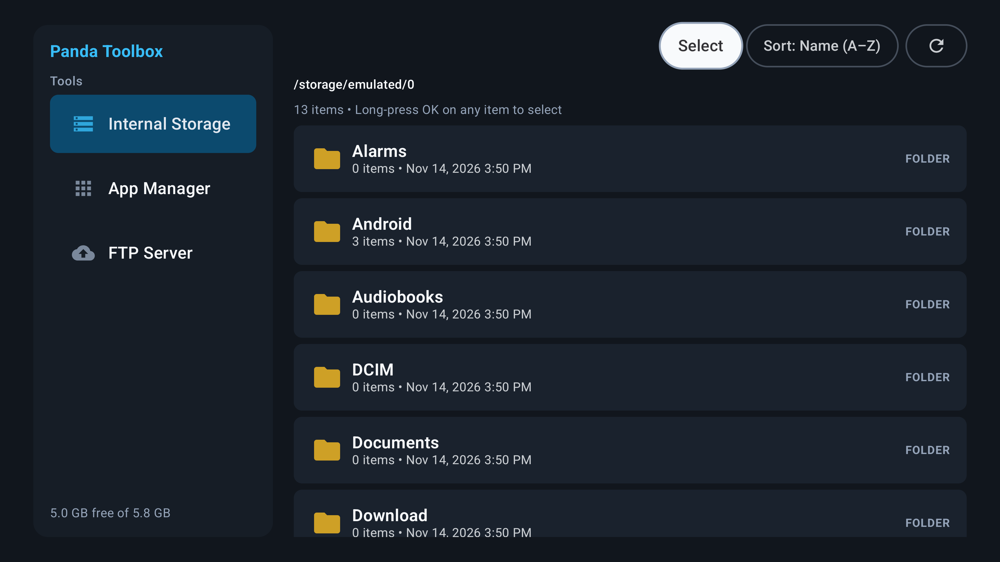

#  Panda Toolbox

**Panda Toolbox** is an easy-to-use utility app for **Android TV**, designed to work smoothly with your TV remote. It brings together file browsing, media playback, app management, and wireless file transfers in one clean interface.

## Screenshots

## What You Can Do

- 📁 **Browse & Manage Files**
  Explore your TV's internal storage as well as connected USB drives and SD cards. Sort files by name, size, or date, view file details, select multiple items to delete at once, and install APK files directly.

- 🎬 **Watch, Listen & View**
  Open videos, music, and photos right inside the app without needing extra players—complete with simple TV remote playback controls.

- 📱 **Manage Your Apps**
  See your installed apps, check which ones are currently active, view available memory, and jump straight to an app's settings page to force stop or uninstall it.

- 📡 **Transfer Files Wirelessly (FTP)**
  Turn on the built-in FTP server with one click to send or receive files between your computer or phone and your TV over your home Wi-Fi or Ethernet network.

## Designed for Your TV Remote

- Navigate effortlessly using your remote's directional pad.
- Press the **Menu** button (or hold **Back**) at any time to jump back to the main sidebar.
